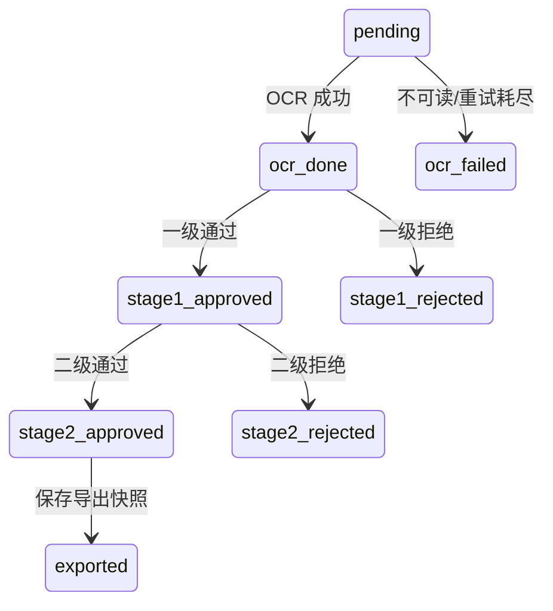

# Gekko 实习测试：分析与任务地图

日期：2026-10-12（香港）。原题基线：`d17c972e811d36f92f9dd43506aff836785a7501`。

**状态：需求分析完成，以下为建议方案，尚未由 Alex 确认或实现。** 用户说明还有一整周；工作量估计不是完成时间承诺。本文件是设计建议和任务地图，后续再细化具体代码实施步骤。

## 1. 目标与边界

建立证券开户身份核验 API：上传 CSV → 后台 OCR → 一级审核 → 二级审核 → 导出 CSV → 开户交付，并用 Docker/nginx 启动、诊断和备份。无需前端。

成功不仅是代码能运行，还包括 Alex 能解释并现场修改代码。每个模块完成后安排讲解和小改动练习，不为分数加入无法解释的框架。

依据：[原题](README.md)、[Q1](q1_api/README.md)、[Q2](q2_integration/README.md)、[Q3](q3_deploy/README.md)、[OCR 合约](mock_ocr/README.md)、[开户合约](mock_onboarding/README.md)。自选行为必须在提交说明中注明；原题优先。

| 模块 | 分数 | 核心验收 |
|---|---:|---|
| Q1 | 35 | CSV 行级错误、批次查询/分页、集中状态转换、业务测试 |
| Q2 | 35 | 后台 OCR、有限重试、进程中断恢复、不可变导出与幂等交付 |
| Q3 | 30 | 干净克隆可启动、代理与 readiness、在线备份/保留七份/恢复、完整 smoke test |
| 加分 | 10 | 核心完成后建议 CI；最终提交 workflow 必须实际通过 |

## 2. 当前起点

- 只有 `/api/health` 骨架；尚无数据库、上传、审核、OCR、导出业务。
- `.venv/bin/python -m pytest q1_api/`：`1 passed`，仅上游导入测试。
- 现有环境准备见 [环境报告](ENVIRONMENT_REPORT.zh-CN.md)；本轮没有重新验收 Docker。
- CSV 50 行；按本轮建议校验规则，预期接受 43、拒绝 7；接受行中 badscan=5。
- 原始 mock 小规模实测：20 次可读 OCR 请求中 10 成功、6 次 500、4 次延迟；成功字段一致。单独 badscan 返回 422。开户首次超时，同键重试获回执，只有 1 次 ingestion。
- 这些是合约探测，**不是应用验收或最终故障率测量**。方法、局限和证据见 [过程记录](WORK_LOG.zh-CN.md)。

## 3. 技术路线

| 路线 | 优点 | 代价/边界 | 建议 |
|---|---|---|---|
| SQLite + 单 API 进程 + 进程内后台任务 | 无新增数据库依赖；事务便于审核和导出一致性；原生启动简单 | 单 worker；持久化恢复必须自己设计 | **推荐**，适合 50 行规模及有限工作量 |
| MongoDB + 同一后台模型 | 符合题目推荐；自然存 OCR JSON | 驱动、独立服务、备份及跨记录一致性成本 | 若希望重点展示 MongoDB，再选择 |
| 数据库 + 独立队列/worker | 任务生命周期独立，便于扩展 | 更多服务、运维和理解成本；超出本题固定布局 | 当前不采用，面试解释升级条件即可 |

推荐 SQLite 是基于题目明确接受、事务适配与范围控制，不代表它在所有场景优于 MongoDB。先完成 100 分核心，再做加分。

## 4. 建议设计

### 文件与数据边界

保持 `app.main:app`；Q2 扩展同一个应用。业务代码全部在 `q1_api/app/`，测试在 `q1_api/tests/`，不新增顶层应用目录。

| 拟修改/新增文件 | 职责 |
|---|---|
| `q1_api/app/main.py` | HTTP 边界、路由、应用生命周期、health/readiness |
| `q1_api/app/db.py` | 建表、连接、短事务、查询与条件更新 |
| `q1_api/app/imports.py` | CSV 解码、表头/行校验、拒绝原因 |
| `q1_api/app/workflow.py` | 集中定义状态转换和审核规则 |
| `q1_api/app/ocr.py` | HTTP 调用、超时重试、后台调度、结果保存 |
| `q1_api/app/exports.py` | 导出快照、内容/键、交付与回执 |
| `q3_deploy/` 既有文件 | 容器、Compose、nginx、配置、备份、smoke test、runbook |

先保持少量清晰模块，配置集中，确有复用再提取。参考规模是 Q1 约 500 行、Q2 额外约 400 行，不为压行数牺牲可读性，也不套多层抽象。

建议持久化 `batches`（导入统计/拒绝原因）、`cases`（原申请/OCR 字段/状态/错误）、`exports`（成员、不可变 CSV 字节/文件名/哈希、键/交付状态/回执）。保留必要的审核 stage/decision/time。

### CSV 与查询约定

- 选 multipart 文件上传，避免让 API 接受任意服务器文件路径。
- 六字段非空，清理首尾空白；接受 UTF-8/BOM；两个日期必须严格 `YYYY-MM-DD` 且有效；证件号要求合成 `TEST-ID-` 前缀。不擅加年龄、签发日期或身份证唯一性政策。
- 同文件 case_ref 首次出现占位，后续重复拒绝；数据库唯一约束 `(batch_id, case_ref)`。重复上传创建新批次。这是题目未指定重复范围时的建议，需明确披露。
- 文件级错误（空文件、缺表头、坏编码、列结构损坏）返回明确 4xx；完整但所有行无效的文件可创建 accepted=0 批次。固定空白行计数规则并测试。
- 行级拒绝采用含表头的 CSV 行号，列出字段和原因；一行多错误只计一次 rejected。
- 稳定排序后分页，page ≥ 1，page_size 为 1–100；非法参数/状态 422，不存在资源 404；状态计数包含零。
- **保留申请值和 OCR 值两套来源**。mock OCR 并不保证与上传信息一致，不应覆盖申请值，也不擅自自动拒绝不一致或低置信度案件。

### 状态机

补充 `stage2_rejected`，落实“任一审核阶段拒绝均终止”。拒绝后不可继续审核或导出。重复审核、跳级、OCR 失败后审核返回有原因的 409；请求类型错误返回 422。用旧状态条件更新防止同时审核竞态。

Q1 可用数据库 fixture 将案件置为 ocr_done，独立测试审核；不要为测试加生产用的假 OCR/跳过审核端点。全 HTTP 生命周期在 Q2 接入后验收。

### OCR 后台与恢复

明确只运行一个 Uvicorn worker。采用受应用生命周期管理的进程内后台任务，触发接口返回 202；同批次重复触发返回现有进度，不重开任务。先串行处理，实测需要时再加小并发上限。

在获得最终结果前，案件持久状态保持 pending，不引入容易遗留的 processing 状态。维护内存活动任务集合，异常要记录并清理，网络等待不能阻塞事件循环或占用数据库写事务，数据库连接不跨线程复用。

1. 成功时保存 parsed fields 和 ocr_done；422 保存原始失败原因；400 作为合约/请求问题，不盲目重试。
2. 超时、网络错误和 500 有限重试。暂拟总共 4 次尝试、退避 0.5/1/2 秒；正式 timeout 与参数必须基于 Q2 实测，不照搬本轮 0.3 秒诊断值。
3. 耗尽后 ocr_failed，记录原因、次数、可重试标志；工作人员通过失败筛选定位问题。
4. worker 被终止时未落库案件仍 pending；重启后再调用 process 即恢复，已成功/已审核案件不重跑。
5. 建议 `retry_failed=true` 仅把可重试失败重置为 pending；badscan 不自动重试。修正图片界面不在范围，runbook 指引修正源文件并新建批次。

此处依靠“至少一次请求 + 同图结果确定 + OCR 无业务副作用”。进程内锁不跨实例；多 worker 必须另加持久任务认领/租约或队列，这不是当前方案已支持的能力。

恢复验收按 case_ref 对比 clean run 与 interrupted run 的 OCR 字段/最终状态，排除批次 ID、时间、尝试数。同 seed 不保证不同请求顺序下的故障相同，有限重试也不保证随机服务必成功。需要固定故障序列的确定性测试，加真实 mock 杀进程/重跑证据；有差异如实解释，不伪造完全一致。

### 导出与交付

分开“创建不可变导出”和“交付已有导出”：

1. 一个数据库写事务选取 stage2_approved、生成稳定排序 CSV 字节、创建 export/成员记录，并将这些案件标为 exported。
2. 字节作为持久快照；磁盘 CSV 可由它重建，写文件用临时文件加原子替换，不能只留下可能失效的路径。
3. 提交事务后调用开户 HTTP；失败/超时不把案件退回 stage2_approved。
4. 持久唯一 export_id 派生键，例如 `export:<export_id>`，文件名包含 ID；所有尝试的键和字节相同，不同导出不同键。
5. 核对回执的键、文件名和 sha256 再保存；mock 只按键去重，不会替应用校验不同字节误用同键。
6. 初次 export 调度交付，返回 export_id/状态。建议补 `/api/exports/{id}`、`/api/exports/{id}/download`、`POST /api/exports/{id}/deliver`，用于状态、取文件、明确重试。
7. 无新批准案件时建议返回 200、export=null、count=0，不创建空文件/新提交。并发 export 不能拿到相同案件。

远端已收件、本地未保存回执时仍用原 export/key 重试。开户 mock 的去重状态只存内存，验收重试期间不重启或 reset；它不能提供跨 mock 重启的去重保证，需披露限制。

### 部署与运维

- 固定服务名 api/mock_ocr/mock_onboarding/nginx；SQLite 无单独数据库服务，用 API 持久卷。
- `/api/health` 做 liveness；建议 `/api/ready` 真实连接已配置数据库并读业务表，失败 503；不能仅检查文件存在或创建空数据库就返回 ready。
- mocks `/online` healthcheck；API 等待 mocks healthy；nginx 等待 API ready 和 OCR healthy。使用 `condition: service_healthy`，不靠 sleep。
- 代理保留 `/api/*` 和 `/ocr/*` 路径；测试上传体积限制和 proxy timeout。直接 OCR 代理超时与后台 process 快速返回是不同场景。
- `.env.example` 放非秘密样例；干净克隆可按 runbook 启动。建议样本随镜像提供，由 smoke test 导入；Q3 必须明确并验证对原题 seeded 的解释，避免重启重复灌入。
- 在线备份用 SQLite 一致性备份方法，不能运行中简单复制主 db/遗漏 WAL；同秒文件名不覆盖；只清理指定备份目录内匹配文件，保留最新七份。
- 恢复时停止写入，保存当前数据，先恢复到隔离环境核对批次/案件/导出。文件存在不等于恢复成功。

## 5. 任务与验收

核心估计约 10–12 小时，额外学习和返工另计。按模块每天推进也可以。每个任务按“有意义的失败测试 → 最小实现 → 验证 → 保存依据”循环；**任务粒度不等于提交粒度，整模块验收后一次提交。**

| ID | 状态 | 依赖/估时 | 交付与通过条件 |
|---|---|---|---|
| T0 需求/合约 | 本轮完成 | 约 1h | 原题、结构、Git、mock 探测、任务地图；方案待审阅 |
| T1 导入/查询 | 待做 | T0 方案明确；1–1.5h | db/imports/routes；43 接受/7 拒绝，错误行 6/13/18/19/28/41/48；过滤/分页、重启读回 |
| T2 审核/Q1 测试 | 待做 | T1；1–1.5h | 状态集中；通过/拒绝、≥3 个 409、同时审核；Q1 测试通过，提交 Q1 |
| T3 后台 OCR | 待做 | T2；约 1h | 202 快速返回、可查进度、保存结果、badscan 理由可查 |
| T4 重试/恢复 | 待做 | T3；1–1.5h | 500/超时后成功、永久失败、耗尽、重复触发、杀进程重启重跑；debug 日志与终态对比 |
| T5 导出/交付 | 待做 | T2/T4；1–1.5h | 精确成员、再次导出不重复、并发导出；远端收件超时/本地重启后同键交付，1 次 ingestion；提交 Q2 |
| T6 容器/代理 | 待做 | T5；约 1h | Docker/Compose/nginx/env；两条路由、体积超限 413、DB 故障 ready=503、持久化和健康依赖 |
| T7 备份/手册 | 待做 | T6；约 1h | 在线生成至少 9 份演示保留七份；隔离恢复并核对数据；runbook 四类指令实测 |
| T8 最终验收 | 待做 | T7；约 1h | smoke 完整流程；临时干净 clone 的 pytest/Compose/smoke；原生三进程验证；证据和文档完成，提交 Q3 |
| T9 CI | 可选 | 核心通过；0.5–1h | `.github/workflows/ci.yml`，每 push 跑 pytest/compose build，最终 hash 真正绿灯；单独提交 |
| T10 面试练习 | 待做 | 各模块后；1–2h | 解释数据流/重试/事务；练习新增审核状态、按案件开户、nginx 限流；记录仍不理解之处 |

CI 的 `.github/` 是可选题所需的配置扩展，不是第二个应用目录。核心先做，不让加分挡住验收。

重点异常测试：Q1 空/坏文件、BOM、无效日期、重复、全拒绝、404/422/409 区分；Q2 畸形响应、网络故障、任务异常、幂等恢复、快照提交后退出/远端 ingestion 后回执未落库；Q3 不依赖 `.gekko-setup/`、代理限额边界、同秒备份、恢复后 export/回执存在。破坏性测试仅操作独立测试库。

## 6. Git 管理

本轮原 main 保留在题目 commit；创建 `codex/assessment-plan`。准备提交 `f1ab81c`（`chore: preserve verified local assessment setup`）保存进入本轮前已有七文件环境改动，不冒充 Q1。分析文档另作 docs 提交，最新 hash 以 `git log -1 --oneline` 为准。

1. 后续从本分支继续，或创建 `codex/assessment-implementation` 指向本分支。单人顺序实现，无需三个长期模块分支。
2. Q1/Q2/Q3 各一次完整模块提交，含代码、测试、REFLECTION、AI_LOG。例如 `feat(q1): validate imports and enforce review workflow`、`feat(q2): recover OCR and deliver exports idempotently`、`feat(q3): deploy and verify backup recovery`。
3. 保留真实开发历史，不 force-push，不事后 squash/amend 已发布记录。模块中途保存文件和日志；必要修复如实保留，不为了凑三个 commit 重写历史。
4. 按具体文件暂存，检查 `git diff --check`、对应测试及 `git diff --cached`；不提交 .env/凭证/数据库/备份/临时日志。Q3 补 WAL/SHM、备份/导出忽略规则和 `.dockerignore`。
5. 当前 origin 是出题方，不向它推送。正式发布时按题目创建公开个人 fork，核对账号后把出题方设 upstream、个人 fork 设 origin。本轮未 fork/push/提交邮件。
6. 最后从个人 fork 干净 clone 验收，核对最终 hash；之后若修改，重跑受影响验证/CI。仓库 URL/hash 的邮件交付是单独最后动作。

## 7. 记录方式与下一步

| 记录 | 内容/更新时机 |
|---|---|
| 本文件 | 需求、任务和设计变更；写明理由 |
| [WORK_LOG.zh-CN.md](WORK_LOG.zh-CN.md) | 每任务目标、动作、可复核工程依据、命令/结果、失败与下一步 |
| [REFLECTION.md](REFLECTION.md) | 每模块最终采用的设计、实测故障率/恢复/交付/备份、未完成项 |
| [AI_LOG.md](AI_LOG.md) / [TOOLS.md](TOOLS.md) | 影响设计/代码的 AI 交互、采纳/修改建议和实际来源 |
| `q2_integration/evidence/` / `q3_deploy/evidence/` | 小体积合成/脱敏实验、debug、恢复对比、验收摘要 |

决策用“问题 → 选项 → 选择及理由 → 验证 → 局限”记录。保留失败与修正，不把建议写成已实现，不替 Alex 声明已经理解全部 AI 代码。

下一步是审阅 SQLite/单 worker、CSV 重复范围和导出快照方案，再细化 T1/T2 实施步骤并开始开发。每一块都需可演示、可解释，再推进下一模块。
